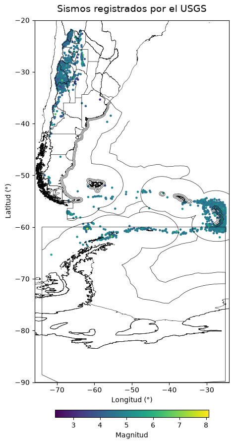
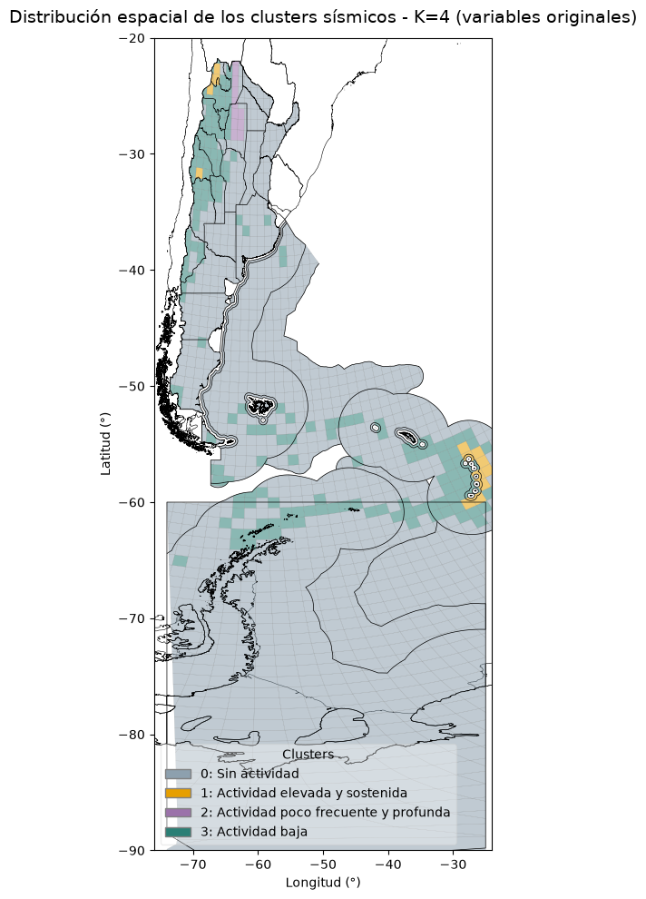

# Análisis de actividad sísmica en Argentina

## Dataset

Para este proyecto se utilizaron datos sísmicos obtenidos del catálogo del *United States Geological Survey (USGS)*. El dataset contiene registros de eventos sísmicos ocurridos en Argentina durante el período 2016 – 2026, incluyendo variables como fecha y hora, ubicación geográfica, profundidad y magnitud, entre otras.

Fuente: [USGS Earthquake Catalog](https://earthquake.usgs.gov/earthquakes/search/)

---
## Contexto y relevancia sismológica en Argentina

Argentina presenta una importante diversidad de ambientes tectónicos y niveles de actividad sísmica. En el noroeste y centro-oeste del país, la subducción de la placa de Nazca bajo la Sudamericana genera una actividad sísmica significativa, que incluye algunos de los terremotos de mayor magnitud registrados en el territorio nacional.

Hacia el extremo sur, la interacción entre las placas Sudamericana, Scotia y Antártica da lugar a un contexto tectónico complejo, con límites convergentes y transformantes. En esta región se destacan el sistema de fallas Magallanes-Fagnano y la actividad del Pasaje de Drake y el arco de Scotia, cuyos eventos también pueden tener repercusiones en zonas pobladas, como Tierra del Fuego.

Por otra parte, existen regiones alejadas de los principales límites de placas donde la actividad sísmica es menos frecuente, aunque no inexistente. Esto no implica que sus efectos potenciales sean menores: la relevancia de un sismo también depende de la población y la infraestructura expuestas, así como de su vulnerabilidad y capacidad de respuesta. En consecuencia, un evento en una región con baja recurrencia sísmica puede generar consecuencias importantes si sus construcciones y servicios no están preparados para afrontarlo.

En este contexto, estudiar la distribución espacial y temporal de los sismos permite caracterizar los distintos patrones de actividad del país y contribuir a una mejor comprensión de la sismicidad nacional y sus posibles implicancias territoriales.

---

## Resumen del proyecto

Caracterizar la actividad sísmica de Argentina mediante el análisis exploratorio de datos y técnicas de aprendizaje automático, con el propósito de identificar patrones espaciales y temporales, estimar la evolución de la actividad sísmica a escala nacional y agrupar regiones según sus características.

---

## Objetivos

* Realizar un análisis exploratorio y construir variables que permitan caracterizar la actividad sísmica.

* Analizar la distribución espacial y temporal de los eventos.

* Desarrollar modelos supervisados para estimar la cantidad acumulada de sismos a escala nacional en distintos horizontes temporales.

* Identificar y caracterizar grupos de regiones con patrones similares de actividad sísmica mediante aprendizaje no supervisado.

---

## Metodología 

---

### 1. Análisis exploratorio

Se realizó un análisis exploratorio para comprender las características del conjunto de datos, evaluar su estructura, calidad y consistencia, e identificar posibles valores faltantes o atípicos. También se analizaron las distribuciones temporales y espaciales de los eventos.

---

### 2. Transformación y preparación de datos

Se llevó a cabo la limpieza y validación de los registros, junto con la construcción y transformación de variables necesarias para el análisis. Se obtuvo un conjunto de datos depurado y estructurado para facilitar su posterior utilización.

---

### 3. Modelo supervisado

Se desarrollaron y compararon distintos modelos de regresión, incluyendo Regresión Lineal, Regresión de Poisson, Random Forest y XGBoost, para estimar la cantidad acumulada de sismos en Argentina en horizontes futuros configurables de hasta 12 meses. Se evaluó su desempeño mediante validación temporal y se compararon sus resultados con métodos de referencia más sencillos.

---

### 4. Modelo no supervisado

Se aplicó el algoritmo K-Means para identificar regiones con patrones similares de actividad sísmica, comparando su aplicación sobre las variables originales estandarizadas y sobre componentes principales obtenidos mediante Análisis de Componentes Principales (PCA). Se analizaron y caracterizaron los grupos resultantes según sus perfiles sísmicos y distribución espacial.

---

## Resultados principales

---

### Análisis exploratorio

El análisis exploratorio permitió identificar las principales características y particularidades del conjunto de datos. Los valores faltantes se concentraron principalmente en las variables de calidad, mientras que no se encontraron valores de magnitud o profundidad que justificaran por sí solos el descarte de registros. También se observó una variación importante en la actividad sísmica durante 2021, asociada principalmente al aumento de eventos registrado en agosto, concentrados en la zona de las Islas Sandwich del Sur.



---

### Modelado supervisado

La comparación de modelos mostró que el tratamiento del pico excepcional de agosto de 2021 tuvo una influencia importante en el desempeño de las estimaciones. Al reemplazar los 600 eventos registrados ese mes por la mediana histórica de 40, se redujeron los errores de validación cruzada en los distintos enfoques evaluados.

La Regresión de Poisson con el conjunto de predictores P2, basado en la actividad del mes anterior y los acumulados de los últimos tres y seis meses, obtuvo el mejor desempeño promedio en la validación cruzada temporal y fue seleccionada como modelo final siguiendo este criterio. En el período reservado para prueba, mostró una mejora moderada respecto del modelo de referencia DummyRegressor. Aunque XGBoost con P4 obtuvo errores menores en ese período, no fue seleccionado porque su desempeño promedio en validación cruzada fue menos favorable.

A partir de la Regresión de Poisson seleccionada se implementaron proyecciones recursivas de hasta 12 meses, que permiten estimar la cantidad acumulada de sismos para distintos horizontes temporales. También se exploró una variante ponderada que combina las estimaciones del modelo con el promedio de los últimos tres meses.

---

### Modelado no supervisado

A partir de una grilla espacial de 100 km, se analizaron 6372 sismos, todos asignados a alguna de las 1332 celdas que la componen. De estas, 204 registraron actividad sísmica durante el período estudiado, mientras que 1128 no presentaron eventos.

El modelo K-Means con cuatro clusters sobre las variables originales estandarizadas fue seleccionado como clasificación general. Permitió distinguir cuatro perfiles: celdas sin actividad registrada, regiones de actividad elevada y sostenida, zonas con actividad poco frecuente y profunda, y áreas de baja actividad.




Como complemento, el modelo K-Means con seis clusters sobre PCA permitió profundizar la caracterización de las regiones de menor actividad, diferenciando 51 celdas con actividad baja a moderada y mayor profundidad media, y 123 con actividad baja predominantemente superficial. Esta clasificación aporta mayor nivel de detalle, aunque presenta menor estabilidad ante cambios en las submuestras de celdas activas que el modelo principal.

El análisis de las celdas con actividad extrema también permitió reconocer comportamientos temporales diferentes. Dos celdas de las Islas Sandwich del Sur concentraron durante agosto de 2021 una proporción importante de sus registros: 120 eventos (23,3 %) y 147 eventos (29,7 %), respectivamente. En cambio, una celda ubicada en Salta registró 793 eventos distribuidos a lo largo de 118 meses activos, de los cuales solamente seis correspondieron a agosto de 2021 (0,76 %). Esto permitió diferenciar zonas cuya elevada actividad está fuertemente influenciada por un episodio puntual de otras con actividad más sostenida.


---

## Aplicaciones potenciales

Los resultados de ambos enfoques pueden complementarse para aportar información de referencia sobre la actividad sísmica en Argentina, considerando tanto su evolución temporal como su distribución espacial. Mientras que el modelo supervisado permite estimar la cantidad de sismos en distintos horizontes temporales, el análisis no supervisado identifica regiones con patrones similares de actividad sísmica.

El pronóstico supervisado tiene alcance nacional y no permite determinar la localización de los eventos futuros; el análisis espacial, por su parte, caracteriza patrones históricos y no constituye una predicción de localización.

La combinación de esta información podría contribuir a la planificación de infraestructura y de operaciones en yacimientos ubicados en regiones expuestas a la actividad sísmica. Conocer las zonas que presentan patrones de mayor actividad y contar con estimaciones de su evolución temporal permitiría orientar necesidades de monitoreo, organizar recursos y contemplar distintos escenarios en la planificación operativa y la preparación ante posibles contingencias.

Asimismo, estos resultados podrían complementarse con información sobre población, características edilicias, rutas, instalaciones energéticas, redes de transporte y otras variables relacionadas con la exposición y la vulnerabilidad. Esto permitiría identificar posibles coincidencias entre las zonas de actividad sísmica y la infraestructura existente, y desarrollar futuros análisis territoriales que contribuyan a la planificación y prevención.

---

## Conclusiones

El proyecto permitió estudiar la actividad sísmica registrada en Argentina mediante el análisis exploratorio, la preparación de los datos y la aplicación de dos enfoques de aprendizaje automático. La exploración inicial permitió reconocer las características del catálogo y detectar algunas particularidades que debían tenerse en cuenta en las etapas posteriores.

En el modelado supervisado, la Regresión de Poisson presentó el mejor desempeño promedio en validación cruzada temporal y una mejora moderada respecto del modelo de referencia en el conjunto de prueba. Las diferencias entre los modelos y los escenarios evaluados también mostraron la influencia de la selección de predictores y del tratamiento de episodios excepcionales. A partir del modelo seleccionado se realizaron proyecciones recursivas para distintos horizontes temporales, que permiten explorar posibles evoluciones de la cantidad de sismos a escala nacional.

El análisis no supervisado permitió distinguir perfiles espaciales con características diferentes. La clasificación de K-Means con cuatro clusters sobre las variables originales ofreció una representación general más compacta, interpretable y estable. Por otro lado, la alternativa de seis clusters con PCA permitió profundizar la caracterización de las zonas de baja actividad, aunque resultó más sensible a los cambios en las submuestras analizadas.

El episodio de agosto de 2021 puso de manifiesto la importancia de considerar la distribución temporal al interpretar los resultados espaciales. Mientras que algunas celdas de las Islas Sandwich del Sur estuvieron fuertemente influenciadas por la concentración de eventos durante ese mes, la celda identificada en Salta presentó una actividad más distribuida a lo largo del período estudiado.

En conjunto, ambos enfoques aportan perspectivas complementarias: el modelado supervisado permite estimar la cantidad de eventos a escala nacional, mientras que el no supervisado ayuda a reconocer diferencias entre regiones según sus características históricas. Estos resultados constituyen un punto de partida para futuros estudios que incorporen períodos más extensos y otras variables, como la exposición de la población y la infraestructura y la vulnerabilidad territorial.

---

## Estructura del repositorio

```text


├── README.md
│
├── data/
│   ├── raw/
│   │   ├── sismos_usgs.csv
│   │   └── geodata/
│   │        ├── limites.cpg
│   │        ├── limites.prj
│   │        ├── limites.shp
│   │        ├── limites.shx
│   │        ├── limites.dbf
│   │        ├── referencias.cpg
│   │        ├── referencias.prj
│   │        ├── referencias.shp
│   │        ├── referencias.shx
│   │        ├── referencias.dbf
│   │        ├── provinciaPolygon.cst
│   │        ├── provinciaPolygon.prj
│   │        ├── provinciaPolygon.shp
│   │        ├── provinciaPolygon.shx
│   │        ├── provinciaPolygon.dbf
│   │        ├── plataforma_continentalPolygon.cst
│   │        ├── plataforma_continentalPolygon.prj
│   │        ├── plataforma_continentalPolygon.shp
│   │        ├── plataforma_continentalPolygon.shx
│   │        └── plataforma_continentalPolygon.dbf
│   │
│   │
│   └── processed/
│       └── sismos_argentina_limpio.csv
│
│
├──imagenes/
│  ├── placas_tectonicas_sudamerica.png
│  ├── distribucion_espacial_eda.png
│  └── mapa_clusters.png
│
│
├── notebooks/
│   ├── 01_analisis_exploratorio.ipynb
│   ├── 02_transformacion_datos.ipynb
│   ├── 03_modelo_supervisado.ipynb
│   └── 04_modelo_no_supervisado.ipynb
│
│

```

---

## Tecnologías y librerías utilizadas


_Lenguaje:_

* Python

_Análisis y manipulación de datos:_

* Pandas
* NumPy
* GeoPandas

_Visualización y análisis geoespacial:_

* Matplotlib
* Shapely

_Modelado y aprendizaje automático:_

* Scikit-learn
* XGBoost

_Otras herramientas y módulos:_

* Requests
* IPython
* Io
* Pathlib
* Itertools
* Os


---

## Integrantes del equipo

Carina Dellasanta,
Fermín Hernando,
Sergio Mamani

Proyecto realizado en el marco del curso **Data Science + IA — Fundación YPF**.